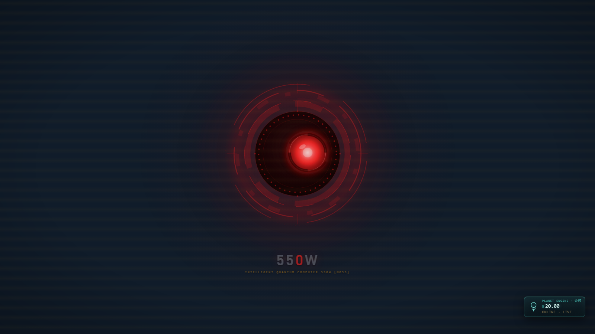
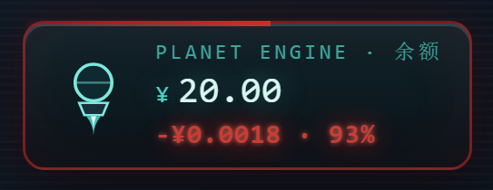
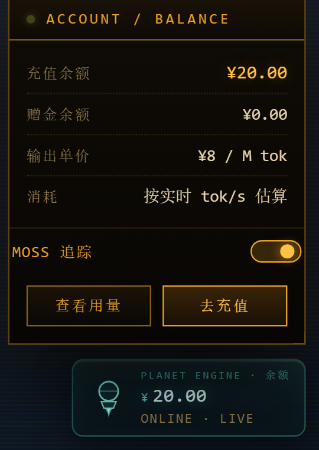

# 550W-MOSS

给 [DeepSeek Harness](https://github.com/deepseek-ai/deepseek-harness)（DSH）的《流浪地球》皮肤：
550C 琥珀终端侧栏 + 深空 HUD 框架 + 会跟着鼠标转的 MOSS 红瞳 + 账户芯片上的实时消耗读数。

纯客户端插件，零运行时依赖，不改 DSH 源码，卸载即恢复原样。



> 截图取自 `plugin/scripts/harness.html`：加载的是同一份构建产物，账户数据是桩数据，
> 不含任何真实姓名、头像、会话标题或余额。

## 安装

已发布到 npm：[`550w-moss`](https://www.npmjs.com/package/550w-moss)

```sh
# 从 npm
dsh plugin --profile web add 550w-moss

# 从本仓库（plugin/ 是包根目录，lib/ 已随仓库提供，无需构建）
git clone <本仓库地址> 550W-MOSS
dsh plugin --profile web add <克隆下来的绝对路径>\plugin

# 从 tar 包
dsh plugin --profile web add .\550w-moss-0.3.1.tgz
```

桌面版（`desktop` profile）只能用 GUI 安装：**Plugins 面板 → 填绝对路径或 tar 包 → 安装 → 重启**。

安装后在 **设置 → 外观** 里保持深色即可（皮肤加载时会自动切到内置 dark 方案）。

## 效果

| 截图 | 说明 |
|---|---|
|  | 生成时账户芯片第三行原地变红：实时消耗 `-¥0.0016 · 93%`，芯片尺寸不变 |
|  | 悬停展开：充值/赠金余额、输出单价，以及 `MOSS 追踪` 开关 |

## 三个区域

1. **左侧栏**：550C 琥珀终端 —— 等宽字、扫描线、描角、分区标题 LED、会话行信号条
2. **主框架**：深空蓝底 `#101c2a`、星场、蓝图网格、四角 HUD 描角，对话区永远压在镜头上层
3. **中心镜头**：手写 SVG 红瞳。**三层环（外圈长弧环、中间装甲块环、内侧刻度环）都在转**，
   转速与方向各不相同；只有黑盘本体、盘沿的红点环与雷达扫掠保持静止。
   中间虹膜呼吸并跟随鼠标做全局追踪。下方 `55` + 红 `0` + `W` 水印锚在输入框下方空带

| 区域 | 内容 |
|---|---|
| 用户条 | 毛玻璃悬浮条（无外框），用户名前带 `高级驾驶员` 军衔徽标 |
| 账户芯片 | 右下角玻璃片，悬停/聚焦展开明细；空闲显示 `ONLINE · LIVE` |
| 550W 水印 | 随侧栏开合平移，镜头永远不左右晃动 |

### MOSS 追踪开关

账户芯片面板里有一行 `MOSS 追踪`（`role="switch"`）。关掉后虹膜缓回正中并停止跟随，
选择写进 `localStorage` 的 `moss-550c:track`，重启依然生效。
没有任何历史选择时，会跟随系统「减少动态效果」（`prefers-reduced-motion`）自动取舍。

## 目录结构

```
550W-MOSS\
├── README.md              ← 本文件
├── LICENSE                ← MIT
├── docs\                  ← 截图（由 harness 生成）
├── 550w-moss-0.3.1.tgz    ← 可分发 tar 包（可选）
└── plugin\                ← 包根目录（npm 包内容）
    ├── skin.css           ← 全部样式与 DSH 设计令牌（唯一真源）
    ├── lens.svg           ← MOSS 镜头几何
    ├── src\client.js      ← 可读源码（无 import/export，构建时内联）
    ├── lib\
    │   ├── client.js      ← 构建产物：window.__ModuleLoader__.load({...}) 单文件
    │   └── index.js       ← Host 半边（空实现）
    ├── cordis.patch.yml   ← profile 层插入行
    └── scripts\
        ├── build.mjs      ← 生成 lib/client.js 并在 VM 沙箱里自检
        ├── harness.html   ← 裸页面：只挂镜头 / 水印 / 芯片，用于检查与截图
        ├── docs-shots.mjs ← 用 harness 重新生成 docs/ 里的截图
        ├── check-identity.mjs
        └── live-shot.mjs
```

## 开发

改 `plugin\skin.css` / `plugin\src\client.js` / `plugin\lens.svg` 之后**必须重新构建**，
否则 `lib\client.js` 不会更新：

```powershell
cd plugin
node scripts\build.mjs   # 等于 npm run build
npm run check            # 语法检查

# 重新生成 docs/ 截图（headless Edge + CDP）
node scripts\docs-shots.mjs
```

构建会校验：loader 格式、导出、色板作用域、镜头挂载、暗色属性、虹膜追踪层的存在，失败即构建失败。

## 实现要点

- 色板写成 CSS，作用域 `body[data-dsh-skin-moss-550c]`（特异性 0,1,1），
  压过内置 `[data-ds-dark-theme]`（0,1,0）；不走主题注册表——内置 presenter 只渲染
  `light/dark/system` 三套。
- 客户端半边必须是单文件 `window.__ModuleLoader__.load({ id, factory })`；
  用 ESM `import` 会让整个 web boot 失败（`1 entry did not activate`）。
- 镜头 `position: fixed; z-index: 0`，对话区抬到 `z-index: 2`，文字永远压在镜头之上。
- 镜头定位带 2px 死区，侧栏开合引起的宽度变化不会让它抖动。
- 追踪偏移写在 `.m-iris-track`（外层 `<g>`）上，呼吸缩放留在 `.m-iris`（内层），
  两者互不覆盖；偏移量以 viewBox 用户单位表示，镜头缩放多少都保持比例。
- 每帧按 0.14 缓动逼近目标，指针停下即停帧，不常驻 rAF。
- 消耗读数取自 `[data-composer-stat]` 药丸（`N tok/s`、`缓存命中 N%`），
  金额由 tok/s 积分后按 `PRICE_OUTPUT_PER_MTOK` 估算。

## 已知限制

- 选择器依赖 DSH 内部结构（`sidebarCol`、`_frame`、`data-conversation-region`、
  `data-composer-seat` 等），宿主大版本升级可能需要跟进。
- 金额是**估算**：DSH 不提供单价与实时 token 总数。单价常量在
  `plugin\src\client.js` 的 `PRICE_OUTPUT_PER_MTOK`（默认 ¥8 / M tok）。
- 只在 DSH `0.2.1-rc.2` 上实测。

## 许可

MIT，见 [LICENSE](LICENSE)。视觉灵感来自《流浪地球 2》与 550C 开机动画项目
（Voidpoket / yannicksong0106）；不含第三方美术资源，镜头与 HUD 均为手写 SVG/CSS。
